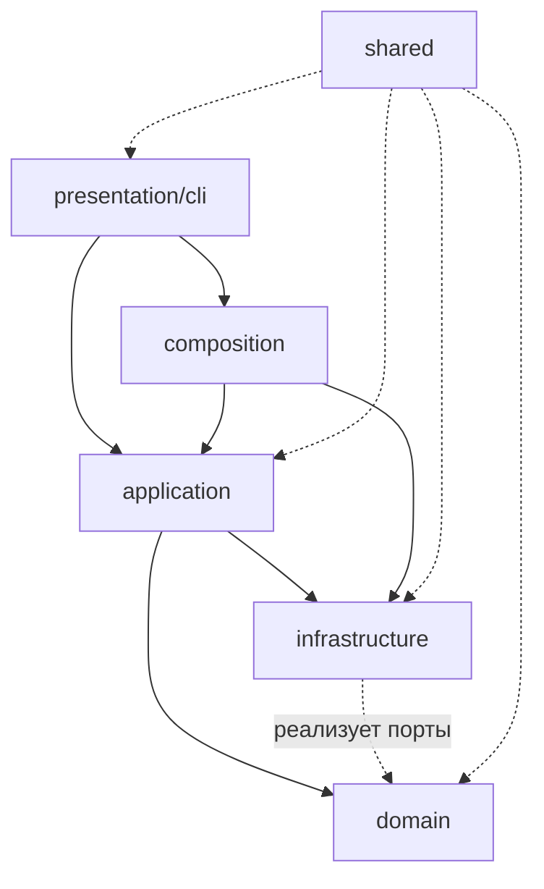

# Архитектура auto-hh-cli

- **Статус:** этапы 1–4 выполнены — структура приведена к целевой (раздел 4), домен не зависит от инфраструктуры, сценарии вынесены в `application/`, документация обновлена.
- **Дата:** 2026-10-19.
- **Ветка:** `refactoring/add-solid`.
- **Состояние кода:** `src/` — 56 файлов, ≈5,9 тыс. строк; `npx tsc --noEmit` → exit 0.

---

## 1. Контекст

CLI-приложение автоматизирует поиск и отклик на вакансии hh.ru. Пайплайн состоит из независимых шагов:

```
search → digest → cover → apply
```

Дополнительно: `digest actualize`, `resume` (загрузка/скачивание), `grade` (оценка резюме ИИ), `schedule` (cron), `config`, `reset`.

Внешние зависимости: hh.ru через Playwright, MongoDB (нативный драйвер), OpenAI-совместимый ИИ, файловая система (`data/`).

---

## 2. Слои и правила зависимостей

Четыре слоя плюс общие утилиты и точка сборки:

| Слой | Ответственность | Может зависеть от |
|---|---|---|
| `domain` | бизнес-правила и модели: фильтр, судья, письма, оценка резюме, актуализация | только `shared` (и ничего из `infrastructure`, `application`, `presentation`) |
| `application` | сценарии (use cases): оркестрация домена и портов | `domain`, `shared`, порты |
| `infrastructure` | адаптеры: hh.ru, ИИ, MongoDB, Playwright, файлы, конфигурация | `domain` (реализует порты), `shared` |
| `presentation` | ввод-вывод: команды, меню, парсинг аргументов | `application`, `composition`, `shared` |
| `shared` | утилиты без бизнес-смысла: логгер, время, ретраи, текст, конкурентность | ничего из слоёв |
| `composition.ts` | единственное место сборки конкретных реализаций | все слои |



Текстовая схема (если Mermaid не отображается):

```
presentation ──▶ application ──▶ domain
      │                │
      └──▶ composition ─┼──▶ infrastructure ──(реализует порты)──▶ domain
                       │
                   shared (без зависимостей от слоёв)
```

Ключевое правило: **домен не импортирует инфраструктуру**. Всё, что домену нужно снаружи (кэш, история, ИИ), описано портами в `domain/ports.ts` и передаётся параметром.

---

## 3. Текущее состояние (as-is)

```
src/
├── browser.ts                  # запуск Playwright (уже вынесен)
├── cli/                        # 20 файлов
│   ├── apply/{config,steps}.ts
│   ├── cmd-*.ts                # 12 команд
│   ├── index.ts                # точка входа CLI
│   └── ui/{menu,options,resume,resume-download,steps}.ts
├── clients/                    # 4 файла
│   ├── ai-client.ts            # OpenAI-адаптер + порт AiProvider
│   ├── db.ts                   # MongoDB
│   ├── hh-client.ts            # скрейпинг hh.ru (619 строк)
│   └── hh-resume.ts            # разбор резюме
├── composition.ts              # сборка зависимостей
├── concurrency.ts              # пул воркеров
├── config.ts                   # config.json + env
├── domain/                     # 14 файлов
│   ├── actualize.ts, adapt-resume.ts, filter.ts,
│   ├── grade-resume.ts, resume-block.ts, resume-markdown.ts
│   ├── collect.ts              # ⚠ сценарий с I/O
│   ├── cover-letter/, judge/, ports.ts
├── env.ts, logger.ts, paths.ts, resume.ts, retry.ts
├── store/                      # 6 файлов: cache, digest, history, resume, search, reset
├── text-utils.ts, time.ts, types.ts
└── (bin/auto-hh → src/cli/index)
```

### Проблемы

1. **Слои не видны по каталогам.** В корне `src/` смешаны утилиты (`time`, `retry`), инфраструктура (`browser`, `config`, `env`), доменные модели (`types.ts`).
2. **`domain/collect.ts` — не домен.** Он выполняет сеть, пишет в кэш, читает историю. Это сценарий (`application`).
3. **`clients/` и `store/` — один слой**, разнесённый по двум каталогам: оба адаптеры к внешнему миру.
4. **Бизнес-логика в командах.** `cmd-digest.ts` (380 строк) содержит фильтрацию, судью и сборку дайджеста; `cmd-cover.ts` (146) — цикл генерации писем; `cmd-apply.ts` (97) — цикл откликов.
5. **`cli/apply/steps.ts` (219 строк)** — Playwright-адаптер, а не слой представления.
6. **Домен смотрит в инфраструктуру:** `domain/resume-markdown.ts` импортирует типы из `clients/hh-resume.ts`.
7. **Загрузка резюме из файлов внутри домена:** `domain/grade-resume.ts` вызывает `loadResume()` (fs) вместо получения данных параметром.

---

## 4. Целевая структура (to-be)

```
src/
├── domain/
│   ├── models.ts               # Vacancy, Resume, Verdict, DigestEntry, HhResume*
│   ├── ports.ts                # CacheStore, HistoryStore, CollectDeps, AiProvider
│   ├── filter.ts
│   ├── resume-block.ts
│   ├── actualize.ts
│   ├── adapt-resume.ts
│   ├── resume-markdown.ts
│   ├── judge/{judge.ts, system-text.ts}
│   ├── cover-letter/{cover-letter.ts, system-text.ts}
│   └── grade-resume.ts
│
├── application/
│   ├── collect.ts              # из domain/collect.ts
│   ├── digest.ts               # из cmd-digest
│   ├── cover.ts                # из cmd-cover
│   ├── apply.ts                # из cmd-apply
│   ├── search.ts               # из cmd-search
│   ├── grade.ts                # из cmd-grade-resume + loadResume
│   └── reset.ts                # из store/reset.ts
│
├── infrastructure/
│   ├── hh/{client.ts, resume.ts}
│   ├── ai/client.ts
│   ├── mongo/{db.ts, cache-store.ts, digest-store.ts, history-store.ts,
│   │          resume-store.ts}
│   ├── files/{resume-loader.ts, search-output.ts}
│   ├── playwright/{browser.ts, apply-steps.ts}
│   └── config/{config.ts, env.ts, paths.ts, apply-config.ts}
│
├── presentation/cli/
│   ├── index.ts
│   ├── commands/cmd-*.ts
│   └── menu/{menu,options,resume,resume-download,steps}.ts
│
├── shared/{logger,concurrency,retry,text-utils,time}.ts
└── composition.ts
```

Отличия от as-is:

- Появились явные `application/`, `infrastructure/`, `presentation/`, `shared/`.
- `domain/` содержит только модели, правила и порты.
- Команды в `presentation` становятся тонкими: парсинг аргументов → вызов сценария → вывод.

---

## 5. Таблица переносов

| Группа | Сейчас | Куда | Причина |
|---|---|---|---|
| Модели | `src/types.ts` | `domain/models.ts` | доменные модели, а не утилита |
| Домен | `domain/{filter,resume-block,actualize,resume-markdown,grade-resume}.ts`, `domain/judge/*`, `domain/cover-letter/*`, `domain/ports.ts` | `domain/` (без перемещения) | уже верный слой |
| Сценарий | `domain/collect.ts` | `application/collect.ts` | сеть + кэш + история |
| hh.ru | `clients/hh-client.ts`, `clients/hh-resume.ts` | `infrastructure/hh/` | адаптер внешнего сайта |
| ИИ | `clients/ai-client.ts` | `infrastructure/ai/client.ts` | адаптер SDK |
| MongoDB | `clients/db.ts`, `store/{cache,digest,history,resume,search}-store.ts` | `infrastructure/mongo/` | адаптеры базы |
| Сброс | `store/reset.ts` | `application/reset.ts` | сценарий, а не хранилище |
| Браузер | `browser.ts`, `cli/apply/steps.ts` | `infrastructure/playwright/` | Playwright-адаптер |
| Файлы | `resume.ts` | `infrastructure/files/resume-loader.ts` | чтение с диска |
| Выдача в файл | `store/search-store.ts` | `infrastructure/files/search-output.ts` | запись `.md` |
| Конфигурация | `config.ts`, `env.ts`, `paths.ts` | `infrastructure/config/` | чтение файлов и env |
| Настройки отклика | `cli/apply/config.ts` | `infrastructure/config/apply-config.ts` | env для Playwright |
| Утилиты | `logger.ts`, `concurrency.ts`, `retry.ts`, `text-utils.ts`, `time.ts` | `shared/` | нет бизнес-смысла |
| Команды | `cli/index.ts`, `cli/cmd-*.ts` | `presentation/cli/` | ввод-вывод |
| Меню | `cli/ui/*` | `presentation/cli/menu/` | ввод-вывод |
| Сборка | `composition.ts` | остаётся в корне `src/` | composition root |

Правило при переезде: меняются только пути в импортах. Расширения `.js` сохраняются (требование `moduleResolution: nodenext`), имена env-переменных и CLI-команд не меняются.

---

## 6. Этапы миграции

Каждый этап завершается проверкой: `npx tsc --noEmit` → exit 0, затем запуск `node bin/auto-hh` (меню открывается). Этапы независимы, но порядок важен.

### Этап 1 — каркас (механический переезд)

1. Создать каталоги `application/`, `infrastructure/{hh,ai,mongo,files,playwright,config}/`, `presentation/cli/`, `shared/`.
2. Перенести файлы по таблице из раздела 5, обновляя импорты.
3. Обновить `bin/auto-hh`: `require('../src/cli/index')` → `require('../src/presentation/cli/index')`.
4. Поправить `tsconfig.json`, если изменился `include` (сейчас `src/**/*.ts` — менять не нужно).

Риск: только битые пути; tsc их ловит. Ожидаемый объём: один коммит, ~80–100 правок импортов.

### Этап 2 — чистота домена

1. Перенести типы `HhResume*` в `domain/models.ts`, чтобы `resume-markdown.ts` не импортировал `infrastructure/hh`.
2. Убрать `loadResume()` из `domain/grade-resume.ts`: резюме передаётся параметром, загрузка — в `application/grade.ts`.

Проверка зависимости: `grep "infrastructure" src/domain` не должен находить совпадений.

**Выполнено (2026-10-19).** Типы `HhResume*` перенесены в `domain/models.ts`; `infrastructure/hh/resume.ts` оставляет реэкспорт, поэтому адаптеры и команды не менялись. `loadResume()` убран из домена: сценарий `application/grade.ts` загружает резюме и передаёт его параметром. Заодно закрыты ещё две утечки: `sanitizeSegment`/`UNKNOWN_REGION` вынесены в `shared/path-utils.ts` (реэкспорт из `paths.ts` сохранён), а `domain/cover-letter/*` больше не читает `config.json` — флаг `adaptResume` передаётся из `cmd-cover`. Проверка: `grep "infrastructure" src/domain` → 0 совпадений, `npx tsc --noEmit` → exit 0.

### Этап 3 — use cases

По одному сценарию, начиная с самого крупного:

1. `cmd-digest.ts` → `application/digest.ts` (фильтр + судья + сборка дайджеста), команда остаётся оболочкой.
2. `cmd-cover.ts` → `application/cover.ts`.
3. `cmd-apply.ts` → `application/apply.ts` (цикл откликов; действия страницы уже в `infrastructure/playwright`).
4. `cmd-search.ts` → `application/search.ts`.
5. `cmd-grade-resume.ts` + `loadResume` → `application/grade.ts`.

**Выполнено (2026-10-19):** все пять шагов — `application/{digest,cover,apply,search,grade}.ts`. Команды только выбирают действие, печатают и выставляют код возврата; порядок вывода сохранён колбэками (`onMatched`, `onVacancy`) и событиями (`SearchEvent`).

После каждого шага: `tsc --noEmit` и ручная проверка соответствующего пункта меню, если доступна база.

### Этап 4 — документация

1. Обновить `README.md`: дерево `src/`, ссылки на файлы.
2. Обновить `docs/review/*` и `REVIEW.md`: старые пути в тикетах помечать как исторические.
3. Отметить в этом документе фактическое состояние (as-is → to-be выполнено).

**Выполнено (2026-10-19):** дерево `src/` в `README.md` соответствует слоям, ссылка на селекторы ведёт в `infrastructure/playwright/apply-steps.ts`; в `REVIEW.md` и `docs/review/README.md` добавлена пометка, что пути в отчётах исторические.

---

## 7. Инварианты (не менять при переносе)

- **Переменные окружения:** все имена `HH_*`, `PW_*`, `AI_*`, `MONGODB_*`, `CONFIG_PATH`, `RESUME_PATH`, `RESUMES_DIR`, `EXCLUDED_COMPANIES`, `APPLICANT_PROFILE`, `REQUEST_DELAY_MS`.
- **CLI и меню:** имена подкоманд, флаги и пункты интерактивного меню.
- **MongoDB:** коллекции `cachePages`, `cacheFull`, `cacheJudgements`, `cacheCoverLetters`, `history`, `digest`, `rejected`, `resumes` и их поля.
- **Файлы:** раскладка `data/` (`search/`, `digests/`, `rejected/`, `resumes/`, `app.log`, `browser-profile/`) и формат `.md`-дайджеста.
- **Точка входа:** `bin/auto-hh` загружает `dotenv`, `tsx/cjs` и вызывает `run()` из `cli/index`.
- **Сборка:** `tsconfig` (`rootDir: src`, `module: nodenext`), импорты с явным `.js`.

---

## 8. Варианты глубины

| Вариант | Что делает | Объём | Риск |
|---|---|---|---|
| **A. Только папки** | Этап 1: переезд файлов, код не трогаем | 1–2 коммита | низкий |
| **B. Слои + use cases** | A + этапы 2–4 | ~6–8 коммитов | средний |
| **C. Полная Clean Architecture** | B + интерфейсы для файлов, времени, логгера; тесты | много | высокий |

**Рекомендация: B.** Сначала A — структура сразу читается, риск минимален. Затем этапами выносить сценарии. Вариант C потребует абстрагировать `fs`, `console`, `Date` и прочее; для CLI это чаще усложняет код, чем помогает.

---

## 9. Точки входа и конфигурация

```
bin/auto-hh
  ├── dotenv.config()            # .env
  ├── tsx/cjs                    # запуск TypeScript без сборки
  └── src/presentation/cli/index.ts → run()
```

- `npm start` → `node bin/auto-hh`; `npm run ui` → `node bin/auto-hh ui`.
- `npm run build` (`tsc`) собирает `src/` в `dist/` — при переносе файлов `rootDir: src` сохраняется, структура `dist/` повторяет новую.
- Пути `data/` резолвятся централизованно в `infrastructure/config/paths.ts` (бывший `src/paths.ts`), поэтому глубина каталога файла больше не влияет на путь.

---

## 10. Статус SOLID-рефакторинга (контекст)

До архитектурного переезда в ветке `refactoring/add-solid` выполнены 12 коммитов:

| Коммит | Что закрыто |
|---|---|
| `d65ad39` | общие утилиты времени, env, пула (`chunk`, `runBatches`) |
| `46ae53d` | числовые env через helpers |
| `e49c9f6` | `withCoverLetters` вместо трёх копий |
| `1c62d02` | `ensureFullVacancies` вместо дублей загрузки карточек |
| `2d95c2d` | порты `CacheStore`/`HistoryStore` (DIP, ISP) |
| `7344c9a` | `selectCandidates` — чистая функция отбора (SRP) |
| `d997047` | единый `openBrowser` и `PROFILE` (D14) |
| `cc7ebee` | шаги из `applyToVacancy` (K2, D12) |
| `13eb4f7` | распил `cmd-apply` на `config`/`steps` |
| `3f28bea` | `hh-client.ts` без `@ts-nocheck` (LSP) |
| `83b0b1f` | composition root для зависимостей сбора |
| `0a858bd` | порт `AiProvider` и адаптер OpenAI (OCP, DIP) |

Что осталось из идей (вне рамок переезда): автотесты (`node:test` + `tsx`) для чистых функций — `selectCandidates`, `filter`, `chunk`, `runBatches`, `parseJSON`, `computeActualization`.


