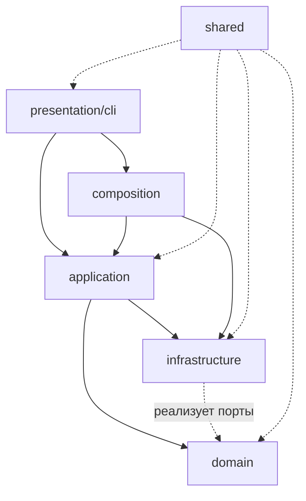
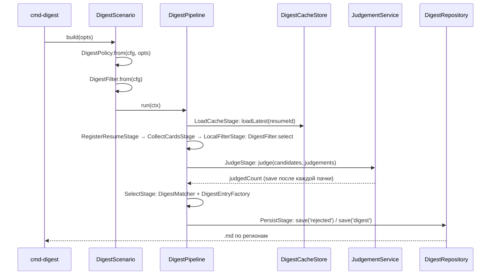

# Архитектура auto-hh-cli

- **Статус:** этапы 1–9 выполнены — структура приведена к целевой (раздел 4), домен не зависит от инфраструктуры, все сценарии в `application/`; поиск (этап 6) и дайджест (этап 7) переведены на ООП (порты, конвейер, репортёр), этап 8 закрыл `apply`/`cover` портами (T-17/T-18) и собрал их как ООП-подсистемы (фасады, конвейеры, стратегии), этап 9 — файловый I/O (T-20), `ConfigProvider` (T-19), чистые `shared`/домен (T-21) и единый composition root с портом `Scheduler` (T-22); документация обновлена.
- **Дата:** 2026-10-19.
- **Ветка:** `refactoring/digest-oop`.
- **Состояние кода:** `src/` — 149 файлов, ≈8,34 тыс. строк; `npx tsc --noEmit` → exit 0.

---

## 1. Контекст

CLI-приложение автоматизирует поиск и отклик на вакансии hh.ru. Пайплайн состоит из независимых шагов:

```
search → digest → cover → apply
```

Дополнительно: `digest actualize`, `resume` (загрузка/скачивание), `grade` (оценка резюме ИИ), `schedule` (cron), `config`, `reset`.

Внешние зависимости: hh.ru через Playwright, MongoDB (нативный драйвер), OpenAI-совместимый ИИ, файловая система (`data/`).

---

## 2. Слои и правила зависимостей

Четыре слоя плюс общие утилиты и точка сборки:

| Слой | Ответственность | Может зависеть от |
|---|---|---|
| `domain` | бизнес-правила и модели: фильтр, судья, письма, оценка резюме, актуализация | только `shared` (и ничего из `infrastructure`, `application`, `presentation`) |
| `application` | сценарии (use cases): оркестрация домена и портов | `domain`, `shared`, порты |
| `infrastructure` | адаптеры: hh.ru, ИИ, MongoDB, Playwright, файлы, конфигурация | `domain` (реализует порты), `shared` |
| `presentation` | ввод-вывод: команды, меню, парсинг аргументов | `application`, `composition`, `shared` |
| `shared` | утилиты без бизнес-смысла: логгер, время, ретраи, текст, конкурентность | ничего из слоёв |
| `composition.ts` | единственное место сборки конкретных реализаций | все слои |



Текстовая схема (если Mermaid не отображается):

```
presentation ──▶ application ──▶ domain
      │                │
      └──▶ composition ─┼──▶ infrastructure ──(реализует порты)──▶ domain
                       │
                   shared (без зависимостей от слоёв)
```

Ключевое правило: **домен не импортирует инфраструктуру**. Всё, что домену нужно снаружи (кэш, история, ИИ), описано портами в `domain/ports.ts` и передаётся параметром.

---

## 3. Текущее состояние

Структура совпадает с целевой (раздел 4): `src/` — 149 файлов, ≈8,34 тыс. строк, `npx tsc --noEmit` → exit 0.

```
src/                              # 149 файлов
├── application/                  # 59 файлов, ≈2,47 тыс. строк — сценарии (use cases)
├── domain/                       # 29 файлов, ≈1,84 тыс. строк — модели, правила, порты
├── infrastructure/               # 31 файл, ≈2,39 тыс. строк — адаптеры hh.ru, ИИ, Mongo,
│                                 #   Playwright, файлы, логирование, планировщик, конфигурация
├── presentation/                 # 20 файлов, ≈1,17 тыс. строк — CLI: команды, меню, форматтеры
├── shared/                       #  9 файлов, ≈0,28 тыс. строк — логгер-фасад, батчи, время,
│                                 #   ретраи, текст
└── composition.ts                # точка сборки зависимостей
```

Счётчики — `Get-ChildItem -Recurse -File src/<слой> -Filter *.ts` на 2026-10-19.

### Раскладка домена

В `domain/` нет I/O: 7 «плоских» файлов (`models`, `ports`, `actualize`, `adapt-resume`,
`resume-block`, `resume-markdown`, `grade-resume`) и четыре подпакета — `search/` (VO запроса и порт
источника), `digest/` (политика, кандидат, вердикты, Domain Services и порты), `judge/` и
`cover-letter/` (правило + промпт).

`filter.ts` перенесён в `domain/digest/` и переписан как Domain Service `DigestFilter`
(2026-10-19): правила `config.filter` и регионы «любые вакансии» задаются в конструкторе
(`DigestFilter.from(cfg)`), наружу — `matches(vacancy)` и `select(items, cache)`. Фильтр
использует только конвейер дайджеста (`application/digest/stages.ts`), поиск его не вызывает.

### Исходные проблемы (as-is до этапов 1–7) — все закрыты

1. **Слои не были видны по каталогам.** В корне `src/` смешивались утилиты (`time`, `retry`),
   инфраструктура (`browser`, `config`, `env`) и доменные модели (`types.ts`)
   → разнесены по `shared/`, `infrastructure/`, `domain/`.
2. **`domain/collect.ts` — не домен.** Он выполнял сеть, писал в кэш, читал историю
   → `application/collect.ts`.
3. **`clients/` и `store/` — один слой** в двух каталогах
   → `infrastructure/{hh,ai,mongo,files,playwright,config}`.
4. **Бизнес-логика в командах.** `cmd-digest.ts` (380 строк) содержал фильтрацию, судью и сборку
   дайджеста; `cmd-cover.ts` (146) — цикл генерации писем; `cmd-apply.ts` (97) — цикл откликов
   → сценарии в `application/`, команды только выбирают действие и печатают.
5. **`cli/apply/steps.ts` (219 строк)** — Playwright-адаптер, а не слой представления
   → `infrastructure/playwright/apply-steps.ts`.
6. **Домен смотрел в инфраструктуру:** `domain/resume-markdown.ts` импортировал типы из
   `clients/hh-resume.ts` → типы `HhResume*` перенесены в `domain/models.ts`.
7. **Загрузка резюме из файлов внутри домена:** `domain/grade-resume.ts` вызывал `loadResume()`
   (fs) → файл читает `application/grade.ts` и передаёт резюме параметром.

---

## 4. Целевая структура (реализована)

```
src/
├── domain/
│   ├── models.ts               # Vacancy, Resume, Verdict, DigestEntry, HhResume*
│   ├── ports.ts                # CacheStore, HistoryStore, DataJanitor, ResumeFiles,
│   │                           #   SearchReportWriter, AppConfig, ConfigProvider, Logger,
│   │                           #   SearchDeps, ResumeSource, SourceProvider, AiProvider
│   ├── resume-block.ts
│   ├── actualize.ts
│   ├── adapt-resume.ts
│   ├── resume-markdown.ts
│   ├── judge/{judge.ts, system-text.ts}
│   ├── cover-letter/{cover-letter.ts, system-text.ts}
│   ├── grade-resume.ts
│   ├── search/                 # VO и порт источника вакансий
│   │   ├── SearchQuery.ts      # config.search → проходы и страницы
│   │   ├── SearchBucket.ts     # проход: префикс, подпись, регион, график
│   │   ├── PageKey.ts          # ключ страницы в кэше + «страница 0 всегда свежая»
│   │   ├── VacancySource.ts    # порт: searchVacancies / getVacancy
│   │   └── types.ts            # VacancyListItem, SearchParams, SearchCacheSnapshot
│   └── digest/                 # VO и порты дайджеста
│       ├── DigestFilter.ts     # Domain Service: локальный пре-фильтр (config.filter)
│       ├── DigestPolicy.ts     # Value Object: minScore/maxRun/dryRun/useJudge
│       ├── DigestCandidate.ts  # кандидат + вердикт фильтра, AcceptedCandidate
│       ├── JudgementSet.ts     # вердикты судьи: pending/merge/toSnapshot
│       ├── DigestMatcher.ts    # Domain Service: отбор accepted/rejected
│       ├── DigestEntryFactory.ts # Domain Service: запись дайджеста + история
│       ├── ports.ts            # DigestRepository, JudgementCache, CoverLetterCache, ...
│       ├── types.ts            # конфиг/флаги запуска/снимок кэша
│       └── index.ts
│
├── application/
│   ├── collect.ts              # flattenCollected (+ реэкспорт fmtSalary из shared)
│   ├── digest.ts               # фасад: buildDigest / showDigest / actualizeDigests
│   ├── cover.ts                # runCover() — обёртка над CoverScenario
│   ├── cover/                  # ООП-реализация писем
│   │   ├── CoverScenario.ts    # Facade: проверки → стратегия режима → результат
│   │   ├── CoverMode.ts        # Strategy: одна вакансия или весь дайджест
│   │   ├── SingleVacancyMode.ts # карточка hh.ru → письмо → cacheCoverLetters
│   │   ├── DigestCoverMode.ts  # конвейер стадий по последнему дайджесту
│   │   ├── CoverPipeline.ts    # Chain of Responsibility: стадии и «стоп»
│   │   ├── CoverStage.ts       # Template Method: enabled → execute → onError
│   │   ├── stages.ts           # дайджест → лимит → письма → карточки → выбор → генерация → запись
│   │   ├── CoverContext.ts     # состояние прогона для стадий
│   │   ├── CoverDeps.ts        # порты сценария, CoverConfig/CoverOutcome/OnVacancy
│   │   ├── CoverPlan.ts        # Value Object: счётчики плана и готовности
│   │   └── index.ts
│   ├── apply.ts                # runApply() — обёртка над ApplyScenario
│   ├── apply/                  # ООП-реализация отклика
│   │   ├── ApplyScenario.ts    # Facade: вход → конвейер плана → сессия → цикл
│   │   ├── ApplyPipeline.ts    # Chain of Responsibility: стадии плана
│   │   ├── ApplyStage.ts       # Template Method: enabled → execute → onError
│   │   ├── stages.ts           # дайджест → архив → лимит → письма → история
│   │   ├── ApplyContext.ts     # план отклика и политики прогона
│   │   ├── ApplyDeps.ts        # порты сценария, ApplyOutcome, ApplySettings
│   │   ├── ApplicationRunner.ts # цикл откликов: вход, пропуски, счётчики
│   │   ├── SkipRules.ts        # Chain of Responsibility: почему пропустить
│   │   ├── DigestSelection.ts  # Strategy: latest/all
│   │   ├── Pacing.ts           # Strategy: пауза (+ Null Object для проверок)
│   │   ├── ApplySummary.ts     # Value Object: ok/fail/skipped
│   │   └── index.ts
│   ├── search.ts               # runSearch() — обёртка над SearchScenario
│   ├── search/                 # ООП-реализация поиска
│   │   ├── SearchScenario.ts   # фасад: сброс → источник → конвейер
│   │   ├── SearchPipeline.ts   # цепочка стадий
│   │   ├── SearchStage.ts      # Template Method: включена → execute → onError
│   │   ├── stages.ts           # страницы, файл, полные карточки
│   │   ├── SearchContext.ts    # состояние прогона для стадий
│   │   ├── SearchEvent.ts      # события фаз + порт SearchReporter
│   │   ├── VacancyCollector.ts # Domain Service: страницы и карточки
│   │   ├── SearchCache.ts      # Repository кэша (cachePages/cacheFull)
│   │   ├── PageIterator.ts     # Iterator страниц прохода
│   │   ├── SearchRequestBuilder.ts # Builder параметров запроса
│   │   └── FullCardPolicy.ts   # Strategy: skipSeen для search/digest/cover
│   ├── digest/                 # ООП-реализация дайджеста
│   │   ├── DigestScenario.ts   # Facade: политика → конвейер → результат
│   │   ├── DigestPipeline.ts   # Chain of Responsibility: стадии и «стоп»
│   │   ├── DigestStage.ts      # Template Method: общий каркас стадии
│   │   ├── stages.ts           # кэш → резюме → карточки → фильтр → судья → отбор → запись
│   │   ├── DigestContext.ts    # состояние прогона для стадий
│   │   ├── DigestEvent.ts      # события фаз + порт DigestReporter
│   │   ├── DigestDeps.ts       # порты сборки/показа/актуализации
│   │   ├── JudgeStrategy.ts    # Strategy: как спрашивать ИИ (батч/поштучно)
│   │   ├── JudgementService.ts # Domain Service: пачки, кэш, частичное сохранение
│   │   ├── DigestShowScenario.ts    # Mongo → письма → .md fallback
│   │   ├── ActualizeScenario.ts     # актуализация digest/rejected
│   │   ├── ActualizeTarget.ts       # цели актуализации (digest/rejected)
│   │   └── index.ts
│   ├── config-view.ts          # просмотр config.json через ConfigProvider
│   ├── grade.ts                # загрузка резюме + оценка
│   ├── resume.ts               # резюме: list / register / show (порт ResumeFiles)
│   ├── resume-download.ts      # скачивание резюме (порты ResumeSource, ResumeFiles)
│   ├── schedule.ts             # прогон пайплайна по cron
│   ├── history.ts              # история откликов (порт HistoryStore)
│   └── reset.ts                # сброс данных (порт DataJanitor)
│
├── infrastructure/
│   ├── hh/{client.ts, resume.ts, vacancy-source.ts, resume-source.ts,
│   │       source-provider.ts}  # адаптеры портов + жизненный цикл браузера
│   ├── ai/client.ts
│   ├── mongo/{db.ts, cache-store.ts, digest-store.ts, history-store.ts,
│   │          resume-store.ts, digest-repository.ts, judgement-cache.ts,
│   │          cover-letter-cache.ts, resume-registry.ts}
│   ├── files/{resume-loader.ts, resume-files.ts, data-janitor.ts,
│   │          search-output.ts, search-report-writer.ts, digest-files.ts,
│   │          digest-file-source.ts}
│   ├── logging/logger.ts        # адаптер LogSink: app.log + DEBUG
│   ├── scheduling/node-cron.ts # адаптер Scheduler: единственный import node-cron
│   ├── playwright/{browser.ts, apply-steps.ts, application-gateway.ts}
│   └── config/{config.ts, env.ts, paths.ts, apply-config.ts}
│
├── presentation/cli/
│   ├── index.ts
│   ├── commands/cmd-*.ts       # только выбор действия и печать
│   ├── format/{grade-report.ts, search-report.ts, digest-report.ts}  # консольные представления
│   └── menu/{menu,options,resume,resume-download,steps}.ts
│
├── shared/{logger,logging,batches,retry,text-utils,time,cron,path-utils,format}.ts
└── composition.ts              # единая точка new HHClient(): vacancySource/resumeSource
```

Отличия от исходного состояния:

- Появились явные `application/`, `infrastructure/`, `presentation/`, `shared/`.
- `domain/` содержит только модели, правила и порты.
- Команды в `presentation` становятся тонкими: парсинг аргументов → вызов сценария → вывод.

### Паттерны поиска (этап 6)

| Паттерн | Где | Что решает |
|---|---|---|
| Adapter + DIP | `infrastructure/hh/{vacancy-source,resume-source}.ts` | сценарии не знают про Playwright |
| Factory + RAII | `HHSourceProvider` | открытие/закрытие браузера в одном месте |
| Repository | `application/search/SearchCache.ts` | сценарий не мутирует `cache.pages` руками |
| Domain Service | `VacancyCollector` | общая догрузка карточек для search/digest/cover |
| Strategy | `FullCardPolicy` | именованные политики вместо флага `skipSeen` |
| Template Method | `SearchStage` | политика ошибок фазы в одном месте |
| Chain of Responsibility | `SearchPipeline` + `stages.ts` | порядок фаз и «стоп» заданы явно |
| Observer | `SearchReporter` / `ConsoleSearchReporter` | печать фаз вынесена в presentation |
| Builder | `SearchRequestBuilder` | параметры запроса hh.ru |
| Iterator | `PageIterator` | кэш/источник и break по страницам |
| Value Object | `SearchQuery`, `SearchBucket`, `PageKey` | правила проходов и ключей кэша |

Инвариант: тексты `log.*`/`console.*` и порядок фаз не изменились — после каждого шага сверялись с HEAD.

### Паттерны дайджеста (этап 7)

| Паттерн | Где | Что решает |
|---|---|---|
| Value Object | `domain/digest/{DigestPolicy,DigestCandidate,JudgementSet}.ts` | флаги прогона, кандидат и вердикты — явные типы вместо `any` |
| Domain Service | `DigestFilter`, `DigestMatcher`, `DigestEntryFactory`, `JudgementService` | правила пре-фильтра/отбора/сборки/судейства без I/O в сценарии |
| Ports & Adapters | `domain/digest/ports.ts` + `infrastructure/{mongo,files}` | домен не знает про Mongo и файловую систему |
| Repository | `MongoDigestRepository`, `DigestCacheStore` | доступ к digest/rejected/кэшу через методы, а не к коллекциям |
| Strategy | `JudgeStrategy`, `ActualizeTarget` | батч/поштучно у судьи; digest и rejected — одним кодом |
| Template Method | `DigestStage` | каркас стадии и проверка «конвейер остановлен» |
| Chain of Responsibility | `DigestPipeline` + `stages.ts` | порядок стадий и ранний выход |
| Observer | `DigestEvent` / `ConsoleDigestReporter` | печать топа и подсказки вынесена в presentation |
| Factory | `DigestEntryFactory` | `DigestEntry` из кандидата + отметка истории |
| Facade | `DigestScenario`, `DigestShowScenario`, `ActualizeScenario` | один вход для команды на каждый шаг |

Ниже — что именно даёт каждый паттерн, а не только где он лежит.

**Value Object — `DigestPolicy`.** Собирает `minScore`, `maxRun`, `dryRun`, `useJudge`, `adaptResume`, размер пачки и параллелизм в один неизменяемый объект. Раньше это были отдельные `const` внутри `buildDigest`, и любая ветка могла прочитать не то поле; теперь политика создаётся один раз и передаётся стадиям. `DigestCandidate`/`AcceptedCandidate` фиксируют форму кандидата, а `JudgementSet` инкапсулирует `Map` вердиктов и даёт операции `pending()`, `merge()`, `toSnapshot()`.

**Domain Service — `DigestMatcher`.** Правило «кто в дайджест, кто в rejected» вместе с лимитом `maxRun` и логами вердиктов; I/O здесь нет, поэтому правило проверяется без Mongo. `DigestEntryFactory` превращает принятого кандидата в `DigestEntry` и отмечает историю (`markApplied` с `digestOnly`), поэтому формат записи и побочный эффект живут в одном месте. `JudgementService` оркестрирует пачки и сохранение, но сам вызов ИИ спрятан за стратегией.

**Domain Service — `DigestFilter`.** Локальный пре-фильтр: правила `config.filter` (архив, компании, ключевые слова, зарплата, локация) и регионы «любые вакансии» из `config.search.area` собираются один раз в конструкторе (`DigestFilter.from(cfg)`), наружу — `matches(vacancy)` и `select(items, cache)`. Раньше это были функции с мешком `any` (`vacancyMatchesFilter`/`selectCandidates`); теперь фильтр создаётся в `DigestScenario` и передаётся стадии через контекст, а `LocalFilterStage` только логирует пропуски и отмечает историю.

**Ports & Adapters — `domain/digest/ports.ts`.** `DigestRepository`, `JudgementCache`, `CoverLetterCache`, `ResumeRegistry`, `ResumeProvider`, `DigestFileSource` и `DigestCacheStore` описывают ровно то, что нужно сценарию. Реализации — в `infrastructure/mongo` и `infrastructure/files`; `Select-String 'infrastructure/(mongo|files|hh)' src/application/digest` не находит совпадений. Конфиг приходит через `DigestDeps.config` (`ConfigProvider`, T-19), а не читается сценарием с диска.

**Repository — `MongoDigestRepository`.** Прячет выбор `writeDigest`/`writeRejected` и `writeActualDigest`/`writeActualRejected` за `save(kind)`, `saveActual(kind)`, `latest()`, `byDate()`, `all()` и `listDocs()`. `ActualizeScenario` больше не держит таблицу функций записи: цели описаны `DigestKind` и `ActualizeTarget`, поэтому новый артефакт добавляется одной строкой.

**Strategy — `JudgeStrategy`.** `AiJudgeStrategy` — боевые вызовы `judgeVacanciesBatch` и `judgeVacancy`; в проверках подставляется детерминированная стратегия, и `JudgementService` не меняется. `ActualizeTarget` применяет ту же идею к актуализации: `digest` и `rejected` отличаются только `kind` и подписью в логе.

**Template Method — `DigestStage`.** `run()` проверяет, не остановлен ли конвейер, и вызывает `execute()`; стадия не дублирует эту проверку. Ошибки не глушатся: падение пачки судьи пробрасывается наверх (`onError: throw`), как в прежнем `buildDigest`.

**Chain of Responsibility — `DigestPipeline`.** Стадии `LoadCache → RegisterResume → CollectCards → LocalFilter → Judge → Select → Persist` идут строго по порядку; `stop` возвращается при пустом кэше, пустой выдаче и в dry-run. Порядок и тексты логов совпадают с прежней реализацией — это проверено скриптом сверки литералов.

**Observer — `DigestEvent`.** Сценарий сообщает `matched` и `digest-saved`, не зная про консоль; `ConsoleDigestReporter` печатает TOP MATCHES и подсказку про письма. Команда стала 44 строки: выбрать действие и подключить репортёр.

**Factory — `DigestEntryFactory`.** Один конструктор записи: поля `id/title/employer/area/salary/url/publishedAt/score/reason/comment/coverLetter` формируются в одном месте. Для rejected используется тот же тип без письма и комментария (`RejectedEntry`), поэтому формат `.md` не меняется.

**Facade — `DigestScenario`.** Команда вызывает `build(opts)`; внутри — `DigestPolicy.from`, `withSource`, конвейер и результат. `DigestShowScenario` и `ActualizeScenario` дают такой же простой вход для `show`/`actualize`, а `application/digest.ts` оставляет совместимые `buildDigest`/`showDigest`/`actualizeDigests`.

Поток сборки:



Показ и актуализация — отдельные сценарии с теми же портами: `DigestShowScenario` (Mongo → письма → `.md` fallback) и `ActualizeScenario` (документы → `computeActualization` → перезапись и `actual.md`).

### Паттерны отклика (этап 8)

| Паттерн | Где | Что решает |
|---|---|---|
| Ports & Adapters + RAII | `domain/ports.ts` + `infrastructure/playwright/application-gateway.ts` | сценарий не знает про Playwright, браузер закрывается в `finally` |
| Facade | `ApplyScenario` | команда вызывает `run(opts)`, внутри — стратегия, конвейер и сессия |
| Template Method | `ApplyStage` | каркас стадии «включена → execute → onError» |
| Chain of Responsibility | `ApplyPipeline` + `stages.ts` | порядок подготовки плана задан явно |
| Chain of Responsibility | `SkipRules` (`MissingLetterRule` → `AlreadyAppliedRule`) | правила пропуска вакансии — отдельные звенья |
| Strategy | `DigestSelection` | latest/all — два класса вместо ветки `if` |
| Strategy | `Pacing` + `RandomPacing` | пауза между откликами не зашита в цикл |
| Null Object | `NoPacing` | проверки без ожидания |
| Value Object | `ApplySummary` | ok/fail/skipped и их сводка в одном объекте |

**Ports & Adapters — `ApplyDeps`.** `DigestRepository`, `CoverLetterCache`, `HistoryStore`, `ApplicationGateway` и `LoginGateway` — всё, что нужно сценарию; `application/apply/` не импортирует `infrastructure` (совпадения в `Select-String` — только комментарии и литерал `via: 'playwright'`, поле схемы истории).

**Facade — `ApplyScenario`.** `run(opts)` обрабатывает ручной вход, собирает `ApplyContext`, прогоняет конвейер плана и только затем открывает сессию через `gateway.withSession`: ошибка подготовки плана не поднимает браузер, а `finally` адаптера закрывает его при любом исходе. `application/apply.ts` сохраняет прежнюю точку входа `runApply`.

**Strategy — `DigestSelection`.** `LatestDigestSelection` читает `byDate(dateKey())`, `AllDigestsSelection` — `all()`; `digestSelection(type)` выбирает класс по флагу команды. Новый источник (дайджест за конкретную дату) — ещё одна реализация, сценарий не меняется.

**Chain of Responsibility — `SkipRules`.** `SkipRule.check()` идёт по звеньям: `MissingLetterRule` (warn, считается в `skipped`) → `AlreadyAppliedRule` (info, не считается; `digestOnly` не блокирует отклик). Решение несёт уровень лога и вклад в сводку, поэтому `ApplicationRunner` не знает причин пропуска.

**Template Method + Chain — `ApplyStage`/`ApplyPipeline`.** Пять стадий (`LoadDigest → FilterArchived → Limit → AttachLetters → LoadHistory`) заполняют `ApplyContext`; порядок и тексты логов совпадают с прежним `runApply`. Ошибка любой стадии валит прогон (`onError: throw`), как раньше.

**Strategy + Null Object — `Pacing`.** `RandomPacing` инкапсулирует `sleep(rand(MIN_DELAY, MAX_DELAY))`, `NoPacing` — заглушка для проверок. Пауза вызывается только после реальной попытки отклика — пропуски не растягивают прогон (прежнее поведение сохранено).

**Value Object — `ApplySummary`.** Счётчики `ok/fail/skipped` и строка `ok=N, fail=N, skipped=N` формируются в одном месте; наружу — тот же `ApplyOutcome { kind: 'done', ... }`.

### Паттерны писем (этап 8)

| Паттерн | Где | Что решает |
|---|---|---|
| Ports & Adapters | `CoverDeps` + `composition.ts` | `application/cover/` не импортирует `infrastructure`, `files`, `mongo` |
| Facade | `CoverScenario` | проверки резюме/шаблона и выбор режима в одном входе `run()` |
| Strategy | `CoverMode` + `SingleVacancyMode`/`DigestCoverMode` | «одна вакансия» и «дайджест» — классы вместо ветки `if` |
| Template Method | `CoverStage` | каркас стадии «включена → execute → onError» |
| Chain of Responsibility | `CoverPipeline` + `stages.ts` | порядок подготовки и ранний выход (пусто/всё готово/нет описаний) |
| Value Object | `CoverPlan`, `CoverProgress` | счётчики и тексты «Вакансий…», «Сопроводительных готово…» |
| Repository + Domain Service | `SearchCache`, `VacancyCollector`, `AllVacanciesPolicy` | догрузка описаний тем же кодом, что search/digest |
| Observer (callback) | `OnVacancy` | команда печатает заголовок вакансии в прежнем порядке вывода |

**Facade + Strategy — `CoverScenario`/`CoverMode`.** `run()` читает конфиг и резюме один раз, проверяет шаблон и по наличию id выбирает режим. `SingleVacancyMode` открывает источник через `withSource` (RAII), получает карточку, отдаёт её в `OnVacancy`, генерирует письмо и пишет в `cacheCoverLetters`. `DigestCoverMode` собирает `CoverContext` и запускает конвейер.

**Template Method + Chain — `CoverStage`/`CoverPipeline`.** Семь стадий (`LoadDigest → Limit → AttachLetters → EnsureCards → SelectItems → GenerateLetters → PersistDigest`) заполняют контекст. `stop` возвращается при пустом дайджесте/ошибке Mongo, когда все письма уже есть и когда ни у одной вакансии нет описания; тексты и порядок логов совпадают с прежним `coverDigest`.

**Value Object — `CoverPlan`/`CoverProgress`.** `CoverPlan` считает `existing = total - pending` и печатает «Вакансий: N, письма уже есть: N, генерируем: N»; `CoverProgress` — «Сопроводительных готово: N/N» и решает, писать ли дайджест. Логи не могут разойтись с числами, потому что строка и арифметика в одном объекте.

**Repository + Domain Service — без нового кода.** `EnsureCardsStage` читает `cacheFull` через `CacheStore.getFullByVacancyIds`, догружает недостающее `VacancyCollector` с `AllVacanciesPolicy` (просмотренные не пропускаем) и пишет через `SearchCache.saveFull` — тот же путь, что в search/digest.

`application/cover.ts` остался совместимой обёрткой `runCover(vacancyId, opts, deps, onVacancy)`; `cmd-cover.ts` и `composition.ts` не менялись.

---

## 5. Таблица переносов

| Группа | Сейчас | Куда | Причина |
|---|---|---|---|
| Модели | `src/types.ts` | `domain/models.ts` | доменные модели, а не утилита |
| Домен | `domain/{resume-block,actualize,resume-markdown,grade-resume}.ts`, `domain/{judge,cover-letter,digest}/*`, `domain/ports.ts` | `domain/` (внутри слоя `filter.ts` стал `domain/digest/DigestFilter.ts`) | уже верный слой |
| Сценарий | `domain/collect.ts` | `application/collect.ts` | сеть + кэш + история |
| hh.ru | `clients/hh-client.ts`, `clients/hh-resume.ts` | `infrastructure/hh/` | адаптер внешнего сайта |
| ИИ | `clients/ai-client.ts` | `infrastructure/ai/client.ts` | адаптер SDK |
| MongoDB | `clients/db.ts`, `store/{cache,digest,history,resume,search}-store.ts` | `infrastructure/mongo/` | адаптеры базы |
| Сброс | `store/reset.ts` | `application/reset.ts` | сценарий, а не хранилище |
| Браузер | `browser.ts`, `cli/apply/steps.ts` | `infrastructure/playwright/` | Playwright-адаптер |
| Файлы | `resume.ts` | `infrastructure/files/resume-loader.ts` | чтение с диска |
| Выдача в файл | `store/search-store.ts` | `infrastructure/files/search-output.ts` | запись `.md` |
| Конфигурация | `config.ts`, `env.ts`, `paths.ts` | `infrastructure/config/` | чтение файлов и env |
| Настройки отклика | `cli/apply/config.ts` | `infrastructure/config/apply-config.ts` | env для Playwright |
| Утилиты | `logger.ts`, `concurrency.ts`, `retry.ts`, `text-utils.ts`, `time.ts` | `shared/` | нет бизнес-смысла |
| Команды | `cli/index.ts`, `cli/cmd-*.ts` | `presentation/cli/` | ввод-вывод |
| Меню | `cli/ui/*` | `presentation/cli/menu/` | ввод-вывод |
| Сборка | `composition.ts` | остаётся в корне `src/` | composition root |

Правило при переезде: меняются только пути в импортах. Расширения `.js` сохраняются (требование `moduleResolution: nodenext`), имена env-переменных и CLI-команд не меняются.

---

## 6. Этапы миграции

Каждый этап завершается проверкой: `npx tsc --noEmit` → exit 0, затем запуск `node bin/auto-hh` (меню открывается). Этапы независимы, но порядок важен.

### Этап 1 — каркас (механический переезд)

1. Создать каталоги `application/`, `infrastructure/{hh,ai,mongo,files,playwright,config}/`, `presentation/cli/`, `shared/`.
2. Перенести файлы по таблице из раздела 5, обновляя импорты.
3. Обновить `bin/auto-hh`: `require('../src/cli/index')` → `require('../src/presentation/cli/index')`.
4. Поправить `tsconfig.json`, если изменился `include` (сейчас `src/**/*.ts` — менять не нужно).

Риск: только битые пути; tsc их ловит. Ожидаемый объём: один коммит, ~80–100 правок импортов.

### Этап 2 — чистота домена

1. Перенести типы `HhResume*` в `domain/models.ts`, чтобы `resume-markdown.ts` не импортировал `infrastructure/hh`.
2. Убрать `loadResume()` из `domain/grade-resume.ts`: резюме передаётся параметром, загрузка — в `application/grade.ts`.

Проверка зависимости: `grep "infrastructure" src/domain` не должен находить совпадений.

**Выполнено (2026-10-19).** Типы `HhResume*` перенесены в `domain/models.ts`; `infrastructure/hh/resume.ts` оставляет реэкспорт, поэтому адаптеры и команды не менялись. `loadResume()` убран из домена: сценарий `application/grade.ts` загружает резюме и передаёт его параметром. Заодно закрыты ещё две утечки: `sanitizeSegment`/`UNKNOWN_REGION` вынесены в `shared/path-utils.ts` (реэкспорт из `paths.ts` сохранён), а `domain/cover-letter/*` больше не читает `config.json` — флаг `adaptResume` передаётся из `cmd-cover`. Проверка: `grep "infrastructure" src/domain` → 0 совпадений, `npx tsc --noEmit` → exit 0.

### Этап 3 — use cases

По одному сценарию, начиная с самого крупного:

1. `cmd-digest.ts` → `application/digest.ts` (фильтр + судья + сборка дайджеста), команда остаётся оболочкой.
2. `cmd-cover.ts` → `application/cover.ts`.
3. `cmd-apply.ts` → `application/apply.ts` (цикл откликов; действия страницы уже в `infrastructure/playwright`).
4. `cmd-search.ts` → `application/search.ts`.
5. `cmd-grade-resume.ts` + `loadResume` → `application/grade.ts`.

**Выполнено (2026-10-19):** все пять шагов — `application/{digest,cover,apply,search,grade}.ts`. Команды только выбирают действие, печатают и выставляют код возврата; порядок вывода сохранён колбэками (`onMatched`, `onVacancy`) и событиями (`SearchEvent`).

После каждого шага: `tsc --noEmit` и ручная проверка соответствующего пункта меню, если доступна база.

### Этап 4 — документация

1. Обновить `README.md`: дерево `src/`, ссылки на файлы.
2. Обновить `docs/review/*` и `REVIEW.md`: старые пути в тикетах помечать как исторические.
3. Отметить в этом документе фактическое состояние (исходная структура → целевая структура).

**Выполнено (2026-10-19):** дерево `src/` в `README.md` соответствует слоям, ссылка на селекторы ведёт в `infrastructure/playwright/apply-steps.ts`; в `REVIEW.md` и `docs/review/README.md` добавлена пометка, что пути в отчётах исторические.

### Этап 5 — остальные команды (выполнено 2026-10-19)

Все команды без бизнес-логики: `cmd-resume-download` → `application/resume-download.ts`, `cmd-resume` → `application/resume.ts`, `cmd-schedule` → `application/schedule.ts` + `shared/cron.ts`, `cmd-history` → `application/history.ts`, `cmd-grade-resume` → формат в `presentation/cli/format/grade-report.ts`, показ дайджеста и файловый fallback → `application/digest.ts` + `infrastructure/files/digest-files.ts`.

Приём тот же, что на этапе 3: сценарий возвращает исход (`kind`) и события фаз, команда печатает и выставляет код возврата — порядок вывода в консоли сохраняется. Проверка после каждого шага: `tsc --noEmit` → 0, `node bin/auto-hh --version` → 1.0.0, сверка всех сообщений `console.*`/`log.*` со старым файлом.

### Этап 6 — поиск на ООП (выполнено 2026-10-19)

1. VO и порт источника: `domain/search/{SearchQuery,SearchBucket,PageKey,VacancySource,types}.ts`.
2. Адаптеры `HHVacancySource`/`HHResumeSource` и `HHSourceProvider` (открыть → работа → закрыть).
3. `SearchCache` — репозиторий `cachePages`/`cacheFull`; `flatten()` проверен на идентичность прежнему `flattenCollected`.
4. `VacancyCollector` + `SearchRequestBuilder` + `PageIterator` + `FullCardPolicy`.
5. `SearchScenario` + `SearchPipeline` + стадии (`CollectPages`, `ExportSearchFile`, `CollectFullCards`), `runSearch()` остался обёрткой.
6. `ConsoleSearchReporter` в `presentation/cli/format/`; `cmd-search.ts` — 10 строк.
7. digest/cover получают `SourceProvider` и используют тот же коллектор; 8. resume-download — порт `ResumeSource`.
9. Удалён процедурный код `collect.ts` (`collectVacancies`, `ensureFullVacancies`, `searchBuckets`), остались `flattenCollected` и `fmtSalary` (на этапе 7 `fmtSalary` переехал в `shared/format.ts`, в `collect.ts` остался реэкспорт).

Проверка: `new HHClient()` и импорты `infrastructure/hh` остались только в `composition.ts`; `tsc` → 0; порядок событий и тексты сверены на фейковом источнике (`found → files-saved → full-start → full-progress → full-cards → done`, ветка `nothing-found` без `done`).

### Этап 7 — дайджест на ООП (выполнено 2026-10-19)

1. VO и порты: `domain/digest/{DigestPolicy,DigestCandidate,JudgementSet,ports,types}.ts`; `fmtSalary` вынесен в `shared/format.ts` (домен больше не тянет `application/collect.ts`).
2. Domain Services: `DigestMatcher` (правило отбора) и `DigestEntryFactory` (запись + история).
3. Адаптеры: `MongoDigestRepository`, `MongoJudgementCache`, `MongoCoverLetterCache`, `MongoResumeRegistry`, `FileDigestSource`, `FileResumeFiles`; `cache-store` получил `saveJudgementsMap`.
4. `JudgementService` + `JudgeStrategy`: пачки, кэш вердиктов, частичное сохранение и поштучный фолбэк.
5. Конвейер: `DigestScenario` + `DigestStage` (Template Method) + `DigestPipeline` (Chain) + 7 стадий с прежним порядком логов.
6. `DigestShowScenario` и `ActualizeScenario` (+ `ActualizeTarget`); `application/digest.ts` стал фасадом из трёх обёрток.
7. `ConsoleDigestReporter` в `presentation/cli/format/digest-report.ts`; `cmd-digest.ts` — 44 строки.

Проверка: `tsc --noEmit` → 0 после каждого коммита, `node bin/auto-hh --version` → 1.0.0; скрипт сверки литералов `log.*`/`console.*` с `origin/development` — 0 расхождений; smoke на фейковых портах: accept/reject и `maxRun`, dry-run без записей, пустой кэш и пустая выдача, показ mongo/files/none, актуализация и её dry-run, батч-фолбэк и повторное использование вердиктов.

E2E с живыми hh.ru, Mongo и ИИ не запускался — проверка шла на фейковых портах.

### Этап 8 — `apply` и `cover` за порты и на ООП (выполнено 2026-10-19, T-17/T-18)

1. Порты в `domain/ports.ts`: `ApplicationSession` (`ensureLoggedIn`, `apply`), `ApplicationGateway`
   (`withSession` — RAII по образцу `SourceProvider`), `LoginGateway`, `ApplyResult`;
   `CacheStore.getFullByVacancyIds`. `CoverLetterCache` расширен: `attach(entries, { force })` и
   `save(vacancyId, letter)`.
2. Адаптер `infrastructure/playwright/application-gateway.ts` — единственное место, где шаг отклика
   касается Playwright (`openBrowser`, `ensureLoggedIn`, `applyToVacancy`, ручной вход).
3. `application/apply/` — ООП-сценарий: `ApplyScenario` (Facade) + `ApplyPipeline`/`ApplyStage`
   (Chain + Template Method) + пять стадий плана + `ApplicationRunner`; стратегии `DigestSelection`
   и `Pacing`, цепочка `SkipRules`, VO `ApplySummary`. `application/apply.ts` оставил
   `runApply(opts, deps)`; браузер закрывается в `finally` адаптера; `history.load()` — один раз на прогон.
4. `application/cover/` — ООП-сценарий: `CoverScenario` (Facade) + стратегии `CoverMode`
   (`SingleVacancyMode`/`DigestCoverMode`) + конвейер семи стадий (Template Method + Chain)
   + VO `CoverPlan`/`CoverProgress`. `application/cover.ts` оставил
   `runCover(vacancyId, opts, deps, onVacancy)`; `CoverConfig` (шаблон, `adaptResume`,
   `COVER_BATCH_SIZE`) собирает `composition.ts`.
5. `composition.ts`: `applyDeps` + `coverDeps`; `cmd-apply`/`cmd-cover` только передают зависимости.

Проверка: `application → infrastructure` — 26 импортов в 12 файлах → **15 в 10**;
`npx tsc --noEmit` → 0; smoke на фейковых портах: cover — 9 сценариев (одна вакансия,
`not-found`, кэш + пачка с обновлением дайджеста, все письма готовы, `force`, `limit`, пустой
дайджест/ошибка Mongo, нет описаний, нет резюме); apply — 7 сценариев (архивные, `type=all`,
`limit`, `not-logged-in` с закрытием сессии, ручной вход, `ok=false`/исключение в `fail`,
пауза только после реальной попытки).

### Этап 9 — файловый I/O за портами (выполнено 2026-10-19, T-20)

1. Порты в `domain/ports.ts`: `DataJanitor { clearAll(): Promise<ResetSummary> }`,
   `ResumeFiles { ensureDir, list, load, pathFor, exists, save }`,
   `SearchReportWriter { write(entries, opts) }`; `SearchDeps` получил `janitor` и `reportWriter`.
   `ResumeRegistry` расширен `listRegistered()` — список резюме помечает файлы датой регистрации.
2. Адаптеры `infrastructure/files/`: `data-janitor.ts` (перенос очистки `reset.ts` без изменения
   поведения), `resume-files.ts` (list/load/ensureDir/save/пути `.md` и pdf), `search-report-writer.ts`
   (обёртка над `search-output.ts`). `FileResumeProvider` слит с `FileResumeFiles` — один адаптер
   на все сценарии.
3. `application/{reset,resume,resume-download,history}.ts` и `search/{stages,SearchScenario}.ts`
   работают только с портами; сброс приходит в `SearchScenario` через `deps.janitor` и выполняется
   до открытия источника, как и раньше.
4. `composition.ts`: `resetDeps`, `historyDeps`, `resumeDeps`, `resumeDownloadDeps`;
   `searchDeps` собирается с `config`, `janitor` и `reportWriter`; при этом сохранены
   `applyDeps`/`coverDeps` (ООП-подсистемы этапа 8). Команды передают deps, не собирая адаптеры.

Проверка: `Get-ChildItem -Recurse -File src\application -Filter *.ts | Select-String -Pattern 'from "fs"|from "path"|mongo/'` → пусто;
`npx tsc --noEmit` → 0; `node bin/auto-hh --version` → 1.0.0; смоук на фейковых портах —
файлы резюме (save/overwrite/list/load/путь PDF), скачивание с событиями, reset/history/search
через порты, стадия выдачи через `SearchReportWriter` и её ошибка без падения поиска.

### Этап 9.1 — конфиг за портом (выполнено 2026-10-19, T-19)

1. `domain/ports.ts`: `AppConfig` — DTO config.json (`api`, `apply`, `adaptResume`, `search`,
   `filter`, `schedule` + неизвестные ключи) и `ConfigProvider { load(path?) }`; `SearchDeps`
   получил `config`.
2. `infrastructure/config/config.ts`: `FileConfigProvider` — явный путь важнее `CONFIG_PATH`,
   кэш по абсолютному пути, один `configProvider` на процесс; `loadConfig(path?)` остался
   совместимой обёрткой для `cmd-config`.
3. `DigestDeps`, `ActualizeDeps`, `ScheduleDeps` получили `config`; `CoverDeps.config` принимает
   путь. `DigestScenario`, `ActualizeScenario`, `SearchScenario`, `schedule` и `CoverScenario`
   вызывают `deps.config.load(opts.config)` / `deps.config(opts.config)`;
   `process.env.CONFIG_PATH` в `application` больше не присваивается.
4. `composition.ts`: общий провайдер для `searchDeps`, `digestDeps`, `actualizeDeps`,
   `coverConfig` и `aiProvider`; `aiProvider(path?)` берёт ключ/`baseUrl` из того же файла,
   что и сценарий; `runSchedule` передаёт `config` в шаги, `cmd-schedule` получает провайдер
   из composition.
5. `SearchContext.cfg` типизирован `AppConfig`; стадия выдачи пишет через `deps.reportWriter`
   (T-20) и берёт запрос из `cfg.search?.text`.

Проверка: `Get-ChildItem src\application -Recurse -Filter *.ts | Select-String -Pattern 'CONFIG_PATH|config/config'` → пусто;
`npx tsc --noEmit` → 0; смоук провайдера (явный путь, `CONFIG_PATH`, мемоизация, отсутствие
мутации env) и проброса `opts.config` в digest/search/cover/actualize/schedule → exit 0.

### Этап 9.2 — `shared` и домен без инфраструктуры (выполнено 2026-10-19, T-21)

1. `shared/logger.ts` — чистый фасад `LogSink` без `fs`/env; файловая реализация —
   `infrastructure/logging/logger.ts` (единственное место с `LOG_FILE` и `DEBUG`),
   composition root регистрирует sink. Домен получает `Logger` параметром:
   `gradeResume`, `judge*`, `DigestMatcher`, `DigestEntryFactory`, письма.
2. `shared/concurrency.ts` заменён на `shared/batches.ts`: `chunk`/`runBatches` без env и
   глобального логгера; прогресс/ошибки — через необязательный `logger`, параллелизм — параметром.
   Env-настройки `JUDGE_BATCH_SIZE`/`AI_CONCURRENCY`/`COVER_BATCH_SIZE` читает composition
   (`DigestDeps.settings`, `CoverConfig`).
3. `shared/retry.ts` больше не импортирует `openai` и env: transient-ошибки по `err.name`/`status`,
   `attempts`/`baseDelayMs`/`maxDelayMs` передаёт `infrastructure/ai/client.ts`.
4. Профиль и подпись писем (`APPLICANT_PROFILE`, `COVER_SIGNATURE`) приходят из `CoverConfig`;
   домен не читает `process.env`.

Проверка: `Select-String -Path src\shared -Pattern '../infrastructure|from "openai"'` → пусто;
`Select-String -Path src\domain -Pattern 'process.env|shared/logger|shared/concurrency'` → пусто;
`npx tsc --noEmit` → 0; смоук логов (файл, уровни, `Europe/Moscow`) и `retryOnTransient` → ok.

### Этап 9.3 — единый composition root и порт `Scheduler` (выполнено 2026-10-19, T-22)

1. `domain/ports.ts` — `Scheduler { validate, schedule }`; `application/schedule.ts` больше
   не импортирует `node-cron`, а получает планировщик через `ScheduleRuntimeDeps`.
2. `infrastructure/scheduling/node-cron.ts` — единственный `import cron` в проекте; адаптер
   оборачивает async-колбэк, сохраняя обработку ошибок шагов.
3. `composition.ts` — `scheduleDeps` (config + scheduler), `gradeDeps` (ai + resumeFiles + logger)
   и `closeResources()`; `cmd-schedule` добавляет `steps`, `cmd-grade-resume` получает `gradeDeps`.
4. `application/config-view.ts` — просмотр конфига; `cmd-config` берёт `configProvider` из composition.
   `menu/resume*` используют `application/resume` (`listResumeFiles`/`readResumeFile`) и `resumeDeps`.
5. `presentation/cli/index.ts` закрывает Mongo через `closeResources()`; `presentation` не импортирует
   инфраструктуру.

Проверка: `Select-String -Path src\application -Pattern 'node-cron|infrastructure/'` → пусто;
`Select-String -Path src\presentation -Pattern 'infrastructure/'` → пусто; `npx tsc --noEmit` → 0;
смоук `runSchedule` (scheduled/invalid/no-cron, шаги и события), `gradeDeps`, `showConfig` → exit 0.

Ограничения: прямых импортов инфраструктуры в `application`/`presentation` нет. Остались
T-23 (`dependency-cruiser` + `strict`), T-24 (домен без побочек), T-25 (разбить адаптеры hh.ru),
T-26 (тесты на фейковых портах).

---

## 7. Инварианты (не менять при переносе)

- **Переменные окружения:** все имена `HH_*`, `PW_*`, `AI_*`, `MONGODB_*`, `CONFIG_PATH`, `RESUME_PATH`, `RESUMES_DIR`, `EXCLUDED_COMPANIES`, `APPLICANT_PROFILE`, `REQUEST_DELAY_MS`.
- **CLI и меню:** имена подкоманд, флаги и пункты интерактивного меню.
- **MongoDB:** коллекции `cachePages`, `cacheFull`, `cacheJudgements`, `cacheCoverLetters`, `history`, `digest`, `rejected`, `resumes` и их поля.
- **Файлы:** раскладка `data/` (`search/`, `digests/`, `rejected/`, `resumes/`, `app.log`, `browser-profile/`); форматы `digest.md` (поля `id/title/employer/area/salary/url/publishedAt/score/reason/comment/coverLetter`), `rejected.md` (те же без письма и комментария) и `actual.md` (сводный снимок с `archived/lastSeenAt/checkedAt`).
- **Точка входа:** `bin/auto-hh` загружает `dotenv`, `tsx/cjs` и вызывает `run()` из `cli/index`.
- **Сборка:** `tsconfig` (`rootDir: src`, `module: nodenext`), импорты с явным `.js`.

---

## 8. Варианты глубины

| Вариант | Что делает | Объём | Риск |
|---|---|---|---|
| **A. Только папки** | Этап 1: переезд файлов, код не трогаем | 1–2 коммита | низкий |
| **B. Слои + use cases** | A + этапы 2–4 | ~6–8 коммитов | средний |
| **C. Полная Clean Architecture** | B + интерфейсы для файлов, времени, логгера; тесты | много | высокий |

**Рекомендация: B.** Сначала A — структура сразу читается, риск минимален. Затем этапами выносить сценарии. Вариант C потребует абстрагировать `fs`, `console`, `Date` и прочее; для CLI это чаще усложняет код, чем помогает.

---

## 9. Точки входа и конфигурация

```
bin/auto-hh
  ├── dotenv.config()            # .env
  ├── tsx/cjs                    # запуск TypeScript без сборки
  └── src/presentation/cli/index.ts → run()
```

- `npm start` → `node bin/auto-hh`; `npm run ui` → `node bin/auto-hh ui`.
- `npm run build` (`tsc`) собирает `src/` в `dist/` — при переносе файлов `rootDir: src` сохраняется, структура `dist/` повторяет новую.
- Пути `data/` резолвятся централизованно в `infrastructure/config/paths.ts` (бывший `src/paths.ts`), поэтому глубина каталога файла больше не влияет на путь.

---

## 10. Статус SOLID-рефакторинга (контекст)

До архитектурного переезда в ветке `refactoring/add-solid` выполнены 12 коммитов:

| Коммит | Что закрыто |
|---|---|
| `d65ad39` | общие утилиты времени, env, пула (`chunk`, `runBatches`) |
| `46ae53d` | числовые env через helpers |
| `e49c9f6` | `withCoverLetters` вместо трёх копий |
| `1c62d02` | `ensureFullVacancies` вместо дублей загрузки карточек |
| `2d95c2d` | порты `CacheStore`/`HistoryStore` (DIP, ISP) |
| `7344c9a` | `selectCandidates` — чистая функция отбора (SRP) |
| `d997047` | единый `openBrowser` и `PROFILE` (D14) |
| `cc7ebee` | шаги из `applyToVacancy` (K2, D12) |
| `13eb4f7` | распил `cmd-apply` на `config`/`steps` |
| `3f28bea` | `hh-client.ts` без `@ts-nocheck` (LSP) |
| `83b0b1f` | composition root для зависимостей сбора |
| `0a858bd` | порт `AiProvider` и адаптер OpenAI (OCP, DIP) |

Что осталось из идей (вне рамок переезда): автотесты (`node:test` + `tsx`) для чистых функций и правил — `DigestFilter.matches/select`, `chunk`, `runBatches`, `parseJSON`, `computeActualization`.


