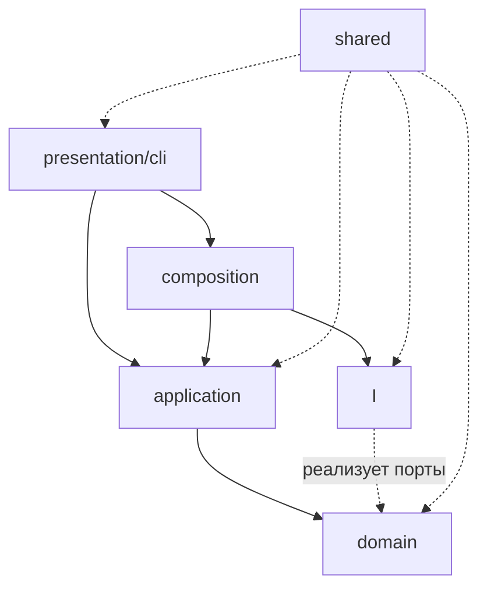

# Архитектура auto-hh-cli

- **Стек:** TypeScript (`nodenext`, `strict`), Node.js ≥ 22.13, CLI на `tsx`; Playwright (persistent
  context), встроенный `node:sqlite` (`data/autohh.db`), OpenAI-совместимый ИИ, `@inquirer/prompts`,
  `node-cron`; тесты — vitest, границы слоёв — dependency-cruiser.
- **Состояние (2026-10-28, ветка `refactor/t-25-t-31`):** `src/` — 183 файла, ≈12,2 тыс. строк;
  `npm run arch` → 0 нарушений (188 модулей), `npx tsc --noEmit` → exit 0, `npx vitest run` →
  23 файла / 136 кейсов.
- **Хранилище:** SQLite — `cache_pages`, `cache_full`, `cache_judgements`, `cache_cover_letters`,
  `history`, `digests`, `resumes`; адаптеры в `infrastructure/sqlite/`.
- **История задач и известный долг:** [`docs/review/`](review/README.md), [`REVIEW.md`](../REVIEW.md).

---

## 1. Контекст

CLI-приложение автоматизирует поиск и отклик на вакансии hh.ru. Пайплайн состоит из независимых шагов:

```
search → digest → cover → apply
```

Дополнительно: `digest actualize`, `resume` (загрузка/скачивание), `grade` (оценка резюме ИИ),
`schedule` (cron), `config`, `reset`.

Внешние зависимости: hh.ru через Playwright, SQLite (встроенный `node:sqlite`),
OpenAI-совместимый ИИ, файловая система (`data/`).

---

## 2. Слои и правила зависимостей

| Слой | Ответственность | Может зависеть от |
|---|---|---|
| `domain` | бизнес-правила и модели: фильтр, судья, письма, оценка резюме, актуализация | только `shared` |
| `application` | сценарии (use cases): оркестрация домена и портов | `domain`, `shared`, порты |
| `infrastructure` | адаптеры: hh.ru, ИИ, SQLite, Playwright, файлы, конфигурация | `domain` (реализует порты), `shared` |
| `presentation` | ввод-вывод: команды, меню, парсинг аргументов | `application`, `composition`, `shared` |
| `shared` | утилиты без бизнес-смысла: логгер, время, ретраи, текст, конкурентность | ничего из слоёв |
| `composition.ts` | единственное место сборки конкретных реализаций | все слои |



`presentation → application → domain`, `composition → infrastructure → domain`, `shared` не зависит
ни от одного слоя. Правила проверяются автоматически: `.dependency-cruiser.js`, `npm run arch`
(нарушение слоя, тип-импорт не туда или цикл → exit ≠ 0); `src/composition.ts` — единственное место,
где известны конкретные классы.

Ключевое правило: **домен не импортирует инфраструктуру**. Всё, что домену нужно снаружи (кэш,
история, ИИ, файлы), описано портами (`domain/ports.ts`, `domain/<подпакет>/ports.ts`) и приходит
параметром `deps`.

---

## 3. Структура проекта

```
src/                              # 183 файла
├── domain/
│   ├── models.ts               # Vacancy, Resume, DigestEntry, HhResume*
│   ├── ports.ts                # CacheStore, HistoryStore, DataJanitor, ResumeFiles,
│   │                           #   SearchReportWriter, AppConfig, ConfigProvider, Logger,
│   │                           #   ResumeSource, SourceProvider, AiProvider, Scheduler
│   ├── logging.ts              # порт Logger для ИИ-вызовов
│   ├── resume-block.ts         # блоки резюме для Markdown
│   ├── resume-markdown.ts      # рендер резюме в .md
│   ├── actualize.ts            # актуализация дайджестов
│   ├── adapt-resume.ts         # адаптация резюме под вакансию (правила)
│   ├── search/                 # VO запроса/прохода, порт VacancySource, FullCardPolicy
│   ├── digest/                 # политика, кандидат, вердикты, Domain Services, порты
│   ├── judge/                  # VO Verdict + тексты промпта
│   ├── cover-letter/           # подпись, шаблон, промпт, CoverSettings
│   └── grade-resume/           # VO ResumeGrade + GradePrompt
│
├── application/
│   ├── search/                 # SearchScenario, Pipeline, стадии, VacancyCollector, SearchCache,
│   │                           #   PageIterator, SearchRequestBuilder, SearchEvent
│   ├── digest/                 # DigestScenario/Pipeline/стадии, DigestJudgeRunner, JudgeStrategy,
│   │                           #   DigestShowScenario, ActualizeScenario
│   ├── cover/                  # CoverScenario, CoverMode, стадии, CoverPlan, CoverDeps
│   ├── apply/                  # ApplyScenario, Pipeline, ApplicationRunner, SkipRules,
│   │                           #   DigestSelection, Pacing, ApplySummary
│   ├── judge/JudgeService.ts   # ИИ-вызовы, разбор вердикта, логи, «ошибка → null»
│   ├── cover-letter/CoverLetterService.ts  # ИИ, пачки, onBatch, fallback на шаблон
│   ├── grade/ResumeGradeService.ts         # ИИ-оценка резюме
│   ├── search.ts / digest.ts / cover.ts / apply.ts   # совместимые фасады run<X>()
│   ├── collect.ts              # flattenCollected (+ реэкспорт fmtSalary)
│   ├── config-view.ts          # просмотр config.json через ConfigProvider
│   ├── grade.ts                # загрузка резюме + оценка
│   ├── resume.ts               # резюме: list / register / show
│   ├── resume-download.ts      # скачивание резюме
│   ├── schedule.ts             # прогон пайплайна по cron
│   ├── history.ts              # история откликов
│   └── reset.ts                # сброс данных
│
├── infrastructure/
│   ├── hh/                     # client (фасад), session, search/vacancy/resume-page-reader,
│   │                           #   resume-dom-blocks, resume-pdf, vacancy-fields/vacancy-mapping,
│   │                           #   resume-raw/codes/lookup/sections/parser,
│   │                           #   vacancy-source, resume-source, source-provider
│   ├── ai/client.ts            # единый OpenAI-совместимый клиент
│   ├── sqlite/                 # db, schema, rows, cache-store, digest-store, history-store,
│   │                           #   resume-store, digest-repository, judgement-cache,
│   │                           #   cover-letter-cache, resume-registry, db-janitor
│   ├── files/                  # resume-loader, resume-files, file-janitor, search-output,
│   │                           #   search-report-writer, digest-files, digest-file-source,
│   │                           #   digest-artifacts, text-file-writer
│   ├── janitor.ts              # композит DataJanitor: файлы (FileJanitor) + БД (DbJanitor)
│   ├── logging/logger.ts       # адаптер LogSink: app.log + DEBUG
│   ├── scheduling/node-cron.ts # адаптер Scheduler: единственный import node-cron
│   ├── playwright/             # browser, apply-steps, application-gateway
│   └── config/                 # config, env, paths, apply-config, cover-config, db-config
│
├── presentation/cli/
│   ├── index.ts
│   ├── commands/cmd-*.ts       # только выбор действия и печать
│   ├── format/                 # grade-report, search-report, digest-report
│   └── menu/                   # menu, options, resume, resume-download, steps
│
├── shared/{logger,logging,batches,retry,text-utils,time,errors,hash,path-utils,format}.ts
└── composition.ts              # точка сборки: источники hh.ru, ИИ, хранилища, closeResources()
```

Размеры слоёв (2026-10-28): `application` — 66 файлов / ≈3,56 тыс. строк, `domain` — 34 / ≈2,56,
`infrastructure` — 52 / ≈4,14, `presentation` — 20 / ≈1,43, `shared` — 10 / ≈0,31.
Счётчики: `Get-ChildItem -Recurse -File src/<слой> -Filter *.ts`.

### Раскладка домена

В `domain/` нет I/O: семь «плоских» файлов (`models`, `ports`, `logging`, `actualize`, `adapt-resume`,
`resume-block`, `resume-markdown`) и пять подпакетов:

| Подпакет | Что внутри |
|---|---|
| `search/` | VO запроса и прохода (`SearchQuery`, `SearchBucket`, `PageKey`), порт `VacancySource`, политика догрузки `FullCardPolicy` |
| `digest/` | `DigestPolicy`, `DigestCandidate`, `JudgementSet`, Domain Services `DigestFilter` / `DigestMatcher` / `DigestEntryFactory`, порты |
| `judge/` | VO `Verdict`, тексты промпта `JudgePrompt` |
| `cover-letter/` | `CoverSignature`, `CoverTemplate`, `CoverLetterPrompt`, `CoverSettings` |
| `grade-resume/` | VO `ResumeGrade`, `GradePrompt` |

В `judge/`, `cover-letter/` и `grade-resume/` нет ни `AiProvider`, ни логгера, ни `parseJSON`:
домен отвечает за правила и тексты, а `application/{judge,cover-letter,grade}/*Service` — за транспорт,
пачки и диагностику. Проверка:
`Select-String -Path src/domain/judge/*.ts,src/domain/cover-letter/*.ts,src/domain/grade-resume/*.ts -Pattern 'AiProvider|chat\(|logger|parseJSON'` → пусто.

`DigestFilter` — Domain Service: правила `config.filter` и регионы «любые вакансии» собираются в
конструкторе (`DigestFilter.from(cfg)`), наружу — `matches(vacancy)` и `select(items, cache)`. Фильтр
использует только конвейер дайджеста (`application/digest/stages.ts`), поиск его не вызывает.

---

## 4. Паттерны по шагам

### Паттерны поиска (этап 6)

| Паттерн | Где | Что решает |
|---|---|---|
| Adapter + DIP | `infrastructure/hh/{vacancy-source,resume-source}.ts` | сценарии не знают про Playwright |
| Factory + RAII | `HHSourceProvider` | открытие/закрытие браузера в одном месте |
| Repository | `application/search/SearchCache.ts` | сценарий не мутирует `cache.pages` руками |
| Application Service | `VacancyCollector` | общая догрузка карточек для search/digest/cover |
| Strategy | `FullCardPolicy` (`domain/search`) | именованные политики вместо флага `skipSeen` |
| Template Method | `SearchStage` | политика ошибок фазы в одном месте |
| Chain of Responsibility | `SearchPipeline` + `stages.ts` | порядок фаз и «стоп» заданы явно |
| Observer | `SearchReporter` / `ConsoleSearchReporter` | печать фаз вынесена в presentation |
| Builder | `SearchRequestBuilder` | параметры запроса hh.ru |
| Iterator | `PageIterator` | кэш/источник и break по страницам |
| Value Object | `SearchQuery`, `SearchBucket`, `PageKey` | правила проходов и ключей кэша |

Инвариант: тексты `log.*`/`console.*` и порядок фаз не менялись.

### Паттерны дайджеста (этап 7)

| Паттерн | Где | Что решает |
|---|---|---|
| Value Object | `domain/digest/{DigestPolicy,DigestCandidate,JudgementSet}.ts` | флаги прогона, кандидат и вердикты — явные типы вместо `any` |
| Domain Service | `DigestFilter`, `DigestMatcher`, `DigestEntryFactory` | правила пре-фильтра/отбора/маппинга без I/O, логов и записи |
| Application Service | `VacancyCollector`, `DigestJudgeRunner` | I/O через порты: карточки, пачки судьи, кэш вердиктов |
| Ports & Adapters | `domain/digest/ports.ts` + `infrastructure/{sqlite,files}` | домен не знает про хранилище и файловую систему |
| Repository | `SqliteDigestRepository`, `DigestCacheStore` | доступ к digest/rejected/кэшу через методы, а не к коллекциям |
| Strategy | `JudgeStrategy`, `ActualizeTarget` | батч/поштучно у судьи; digest и rejected — одним кодом |
| Template Method | `DigestStage` | каркас стадии и проверка «конвейер остановлен» |
| Chain of Responsibility | `DigestPipeline` + `stages.ts` | порядок стадий и ранний выход |
| Observer | `DigestEvent` / `ConsoleDigestReporter` | печать топа и подсказки вынесена в presentation |
| Factory | `DigestEntryFactory` | `DigestEntry` из кандидата (чистый маппинг, без истории) |
| Facade | `DigestScenario`, `DigestShowScenario`, `ActualizeScenario` | один вход для команды на каждый шаг |

- `DigestPolicy` — один неизменяемый объект вместо пачки `const` (`minScore`, `maxRun`, `dryRun`,
  `useJudge`, `adaptResume`, размер пачки, параллелизм); `JudgementSet` инкапсулирует `Map` вердиктов
  и даёт `pending()`, `merge()`, `toSnapshot()`.
- `DigestMatcher` — правило «кто в дайджест, кто в rejected» вместе с лимитом `maxRun`; факты для
  логов возвращает событиями (`DigestSelectionEvent`), печатает их `SelectStage`. Отметку истории
  (`markApplied` с `digestOnly`) и лог `Match` делает та же стадия.
- `DigestEntryFactory` — единственный конструктор записи: поля
  `id/title/employer/area/salary/url/publishedAt/score/reason/comment/coverLetter` формируются в одном
  месте; для rejected — тот же тип без письма и комментария, поэтому формат `.md` не меняется.
- Стадии `LoadCache → RegisterResume → CollectCards → LocalFilter → Judge → Select → Persist` идут
  строго по порядку; `stop` возвращается при пустом кэше, пустой выдаче и в dry-run. Ошибка пачки
  судьи пробрасывается наверх (`onError: throw`), как в прежнем `buildDigest`.

Поток сборки:


Показ и актуализация — отдельные сценарии с теми же портами: `DigestShowScenario` (SQLite → письма →
`.md` fallback) и `ActualizeScenario` (документы → `computeActualization` → перезапись и `actual.md`).

### Паттерны отклика (этап 8)

| Паттерн | Где | Что решает |
|---|---|---|
| Ports & Adapters + RAII | `domain/ports.ts` + `infrastructure/playwright/application-gateway.ts` | сценарий не знает про Playwright, браузер закрывается в `finally` |
| Facade | `ApplyScenario` | команда вызывает `run(opts)`, внутри — стратегия, конвейер и сессия |
| Template Method | `ApplyStage` | каркас стадии «включена → execute → onError» |
| Chain of Responsibility | `ApplyPipeline` + `stages.ts` | порядок подготовки плана задан явно |
| Chain of Responsibility | `SkipRules` (`MissingLetterRule` → `AlreadyAppliedRule`) | правила пропуска вакансии — отдельные звенья |
| Strategy | `DigestSelection` | latest/all — два класса вместо ветки `if` |
| Strategy | `Pacing` + `RandomPacing` | пауза между откликами не зашита в цикл |
| Null Object | `NoPacing` | проверки без ожидания |
| Value Object | `ApplySummary` | ok/fail/skipped и их сводка в одном объекте |

- `ApplyDeps` — всё, что нужно сценарию: `DigestRepository`, `CoverLetterCache`, `HistoryStore`,
  `ApplicationGateway`, `LoginGateway`. `ApplyScenario.run()` обрабатывает ручной вход, собирает
  `ApplyContext`, прогоняет конвейер плана и только затем открывает сессию через
  `gateway.withSession` — ошибка подготовки плана не поднимает браузер.
- `SkipRules` идёт по звеньям: `MissingLetterRule` (warn, считается в `skipped`) →
  `AlreadyAppliedRule` (info, не считается; `digestOnly` не блокирует отклик). Решение несёт уровень
  лога и вклад в сводку, поэтому `ApplicationRunner` не знает причин пропуска.
- `Pacing` вызывается только после реальной попытки отклика — пропуски не растягивают прогон.
  `ApplySummary` формирует строку `ok=N, fail=N, skipped=N`; наружу — тот же
  `ApplyOutcome { kind: 'done', … }`.

### Паттерны писем (этап 8)

| Паттерн | Где | Что решает |
|---|---|---|
| Ports & Adapters | `CoverDeps` + `composition.ts` | `application/cover/` не импортирует `infrastructure`, `files`, `sqlite` |
| Facade | `CoverScenario` | проверки резюме/шаблона и выбор режима в одном входе `run()` |
| Strategy | `CoverMode` + `SingleVacancyMode`/`DigestCoverMode` | «одна вакансия» и «дайджест» — классы вместо ветки `if` |
| Template Method | `CoverStage` | каркас стадии «включена → execute → onError» |
| Chain of Responsibility | `CoverPipeline` + `stages.ts` | порядок подготовки и ранний выход (пусто/всё готово/нет описаний) |
| Value Object | `CoverPlan`, `CoverProgress` | счётчики и тексты «Вакансий…», «Сопроводительных готово…» |
| Repository + Application Service | `SearchCache`, `VacancyCollector`, `AllVacanciesPolicy` | догрузка описаний тем же кодом, что search/digest |
| Observer (callback) | `OnVacancy` | команда печатает заголовок вакансии в прежнем порядке вывода |

- `CoverScenario.run()` читает конфиг и резюме один раз, проверяет шаблон и по наличию id выбирает
  режим. `SingleVacancyMode` открывает источник через `withSource` (RAII), получает карточку, отдаёт
  её в `OnVacancy`, генерирует письмо и пишет в `cache_cover_letters`; `DigestCoverMode` собирает
  `CoverContext` и запускает конвейер.
- Семь стадий (`LoadDigest → Limit → AttachLetters → EnsureCards → SelectItems → GenerateLetters →
  PersistDigest`) заполняют контекст; `stop` — при пустом дайджесте/ошибке хранилища, когда все письма
  уже есть и когда ни у одной вакансии нет описания.
- `CoverPlan` считает `existing = total - pending` и печатает «Вакансий: N, письма уже есть: N,
  генерируем: N»; `CoverProgress` — «Сопроводительных готово: N/N» и решает, писать ли дайджест.
  Строка и арифметика в одном объекте, поэтому логи не расходятся с числами.
- `EnsureCardsStage` читает `cache_full`, догружает недостающее `VacancyCollector` с
  `AllVacanciesPolicy` (просмотренные не пропускаем) и пишет через `SearchCache.saveFull` — тот же
  путь, что в search/digest.

### Паттерны судьи и писем (этап 10, T-27)

| Паттерн | Где | Что решает |
|---|---|---|
| Value Object + Factory | `Verdict.fromModel` / `listFromModel` | инвариант `fit/comment/reason`, clamp 1..10 и обе формы ответа модели в одном месте |
| Value Object | `CoverSignature`, `CoverTemplate`, `CoverSettings` | подпись, шаблон и настройки вместо строк и интерфейса-мешка |
| Domain Service | `JudgePrompt`, `CoverLetterPrompt` | тексты промптов без портов, логов и `try/catch` |
| Application Service | `JudgeService`, `CoverLetterService` | `AiProvider.chat`, пачки, `onBatch`, «ошибка → null», диагностика |
| Strategy | `JudgeStrategy` | `DigestJudgeRunner` не знает, батч это или поштучный запрос |
| Adapter + DIP | `infrastructure/config/cover-config.ts` | env/config.json → `CoverSettings.from(...)`, домен env не читает |

- `Verdict` держит инвариант: при `fit=true` заполняется `comment` (или берётся `reason`, или шаблонная
  фраза), при `fit=false` — `reason`; `score` зажимается в 1..10, строки тримятся. `listFromModel`
  принимает и голый массив (GLM), и `{"verdicts": [...]}`, а `toJudgement()` отдаёт ровно те поля, что
  лежат в `cache_judgements` (`score/fit/reason/comment`).
- Тексты промптов перенесены в домен дословно (системный текст, батчевые добавки, блоки вакансий,
  образец письма). В сервисах остались подписи запросов (`судья <id>`, `судья батч N`, `письма батч N`,
  `письмо`), тексты логов, `try/catch` и порядок `chunk → runBatches → onBatch`.
  `CoverLetterService.generateOne` держит прежний fallback «ИИ → шаблон», `generateBatch` сохраняет
  частичный прогресс после каждой пачки.
- `CoverSettings` хранит дефолты (`опытный разработчик`, пачка 20, параллелизм 10) и клампы
  (бюджет ≥ 500, пачка/параллелизм ≥ 1); `cover-config.ts` только читает env и config.json и вызывает
  `CoverSettings.from(...)`.

### Резюме как измерение данных (2026-10-21)

| Что | Ключ / путь | Где код |
|---|---|---|
| Папки артефактов | `data/hh-parsing/<name> - <resumeId>/{search,digests,rejected}`; без резюме — `no-resume` | `infrastructure/config/paths.ts` |
| Дайджест / rejected | SQLite `digests` (`kind`, `date`, `resume_id`) + `resume_name`, `updated_at` | `infrastructure/sqlite/digest-store.ts` |
| Вердикты ИИ | `cache_judgements` (`date`, `resume_id`, `vacancy_id`) | `infrastructure/sqlite/cache-store.ts` |
| Письма | `cache_cover_letters` (`resume_id`, `vacancy_id`) | `infrastructure/sqlite/cache-store.ts` |
| Реестр резюме | `resumes`: `resumeId`, `name`, `filename`, `contentHash`, `createdAt`, `updatedAt` | `infrastructure/sqlite/resume-store.ts` |
| Запись дайджеста | `resumeId` (кто судил), `coverLetterResumeId` (под кого письмо) | `domain/models.ts` |
| Отклики | `history.meta.resumeId` | `application/apply/ApplicationRunner.ts` |

- `search` / `digest` / `cover` принимают `opts.resume`; writer и репозиторий получают `ResumeRef` и
  сами выбирают папку на диске и ключ записи в SQLite.
- `apply` группирует записи по `coverLetterResumeId → resumeId` и берёт письмо строго под это резюме;
  записи без резюме идут legacy-путём без фильтра.
- Изменение содержимого (sha256 в реестре) при регистрации очищает вердикты и письма этого резюме —
  они относились к старому тексту (`RegisterResumeStage`).
- `DataJanitor` чистит папку резюме, строки `digests`, `cache_judgements`, `cache_cover_letters` и
  отклики этого резюме; кэш `cache_pages`/`cache_full` — только по флагу `includeSearchCache`
  (шаг `search --reset`, который сразу перезапишет кэш). Диск чистит `FileJanitor`, таблицы — `DbJanitor`.

---

## 5. Инварианты (не менять при переносе)

- **Переменные окружения:** все имена `HH_*`, `PW_*`, `AI_*`, `CONFIG_PATH`, `RESUME_PATH`,
  `RESUMES_DIR`, `EXCLUDED_COMPANIES`, `APPLICANT_PROFILE`, `REQUEST_DELAY_MS`.
- **CLI и меню:** имена подкоманд, флаги и пункты интерактивного меню.
- **SQLite:** таблицы `cache_pages`, `cache_full`, `cache_judgements`, `cache_cover_letters`,
  `history`, `digests`, `resumes` и их поля.
- **Файлы:** раскладка `data/` (`search/`, `digests/`, `rejected/`, `resumes/`, `app.log`,
  `browser-profile/`); форматы `digest.md` (поля
  `id/title/employer/area/salary/url/publishedAt/score/reason/comment/coverLetter`), `rejected.md`
  (те же без письма и комментария) и `actual.md` (сводный снимок с `archived/lastSeenAt/checkedAt`).
- **Точка входа:** `bin/auto-hh` загружает `dotenv`, `tsx/cjs` и вызывает `run()` из `cli/index`.
- **Сборка:** `tsconfig` (`rootDir: src`, `module: nodenext`), импорты с явным `.js`.

---

## 6. Точки входа и конфигурация

```
bin/auto-hh
  ├── dotenv.config()            # .env
  ├── tsx/cjs                    # запуск TypeScript без сборки
  └── src/presentation/cli/index.ts → run()
```

- `npm start` → `node bin/auto-hh`; `npm run ui` → `node bin/auto-hh ui`.
- `npm run build` (`npm run arch && tsc`) сначала проверяет границы слоёв, затем собирает `src/` в
  `dist/`; структура `dist/` повторяет `src/`.
- Пути `data/` резолвятся централизованно в `infrastructure/config/paths.ts`, поэтому глубина каталога
  файла не влияет на путь.
- `config.json` читает только `FileConfigProvider` (`infrastructure/config/config.ts`); сценарии
  получают `ConfigProvider` или готовые VO (`CoverSettings`, `DigestPolicy`, `AppConfig`).

---

## 7. История этапов

Подробности, DoD и коммиты — в тикетах [`docs/review/`](review/README.md).

| Этап | Тикеты | Результат |
|---|---|---|
| 1–4 | — | каркас `src/{domain,application,infrastructure,presentation,shared}`, чистый домен, сценарии в `application`, команды-оболочки |
| 5 | — | остальные команды переведены на сценарии (`resume`, `resume-download`, `schedule`, `history`, `grade`) |
| 6 | — | поиск на ООП: `SearchScenario`, `VacancyCollector`, `SearchCache`, `SearchReporter` |
| 7 | — | дайджест: конвейер стадий, `DigestFilter`/`DigestMatcher`/`DigestEntryFactory`, `DigestJudgeRunner`, показ и актуализация |
| 8 | T-17, T-18 | `apply` и `cover` за портами и как ООП-подсистемы (фасады, конвейеры, стратегии) |
| 9 | T-19…T-24 | `ConfigProvider`, файловый I/O за портами, чистые `shared` и домен, composition root + `Scheduler`, `dependency-cruiser` + `strict`, домен без побочек |
| 10 | T-27, T-28 | VO и Domain Services в `judge`/`cover-letter`/`grade-resume`, ИИ-вызовы в `application` |
| 11 | T-25, T-30, T-31 | адаптеры hh.ru разложены на сессию/читателей/парсер, `Scheduler.nextRun()` вместо `shared/cron.ts`, документация и `env()` приведены к коду |
